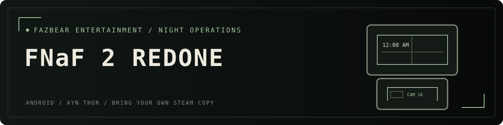
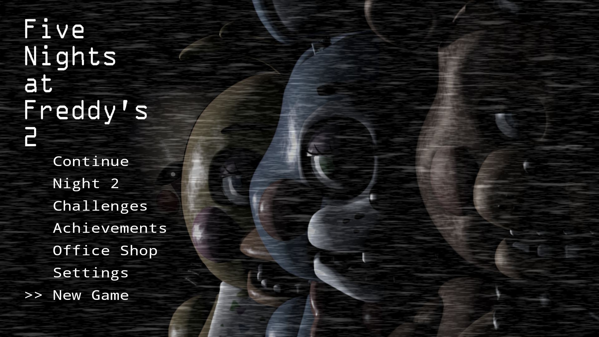

**An enhanced Five Nights at Freddy’s 2 port for Android handhelds.**

Office above. Cameras below. Bring your own purchased Steam copy.

### [Download APK](https://github.com/Maddex712/fnaf2-redone/releases/latest) · [Installation guide](docs/INSTALL.md) · [Report a bug](https://github.com/Maddex712/fnaf2-redone/issues/new)

*Main-menu screenshot captured on AYN Thor. Menu options may vary by version.*

## Welcome back to the night shift

Keep the music box wound, watch the vents, and reach for the Freddy mask.
FNaF 2 Redone pairs the familiar survival loop with physical controller controls,
a 1987 security terminal, and a separate Android installation from FNaF 1 Redone.
It runs locally and offline after importing your game data.

This fan-made port uses a reconstructed runtime. It does not execute the Windows
game or stream a PC. Original artwork and audio come from your purchased Steam copy.
Exact whole-game AI, timing, and RNG parity have not been established.

## What’s inside

| The night shift | Beyond the office |
| --- | --- |
| Nights 1–6 and Custom Night | Rare encounter gallery on the main menu |
| Twelve cameras, vent lights, mask and flashlight | Arcade replays of discovered death minigames |
| Music-box winding and controller quick access | Achievements, points and office plushies |
| Original imported animation and jumpscare frames | 1987 companion terminal and security desk |
| Dream scenes, endings and title stars | Perspective settings and camera panning |
| Automatic controller / mouse / keyboard profiles | Optional Halloween decorations |

## Get playing

1. [Download and install the APK](https://github.com/Maddex712/fnaf2-redone/releases/latest) on your Android device.
2. In Steam, browse FNaF 2's local files and copy `FiveNightsatFreddys2.exe` to Downloads on your Android device.
3. Open **Settings → Scan Steam file → Select Steam file**, then choose the EXE. An existing personal data ZIP also works.
4. Wait for **Ready to play**, then choose **New Game**. Setup runs offline on the device; no PC extraction helper is required.

**Windows:** download the [Windows 0.1.0 ZIP](https://github.com/Maddex712/fnaf2-redone/releases/download/v0.3.12/FNaF2-Redone-Windows-0.1.0.zip). It includes its Java runtime and scans your Steam libraries. See [Windows setup and controls](docs/WINDOWS.md).

For future updates, install the newer APK without uninstalling the game.
Progress and imported game data stay in place. **Uninstalling or clearing app
storage deletes local saves and imported data.**

## Controls

| Input | Action |
| --- | --- |
| X | Raise/lower monitor |
| B | Freddy mask; back in menus |
| L1 / R1 | Hold left/right vent light |
| A | Office/camera flashlight; menu confirm |
| L2 | Hold camera flashlight |
| R2 | Open CAM 11 and wind; release behavior is configurable |
| D-pad | Select cameras/menus; move in minigames |
| Left stick | Office panning; minigame movement |
| Right stick | Pan the current camera |
| Y | Mute phone call |
| Start / Back / Select | Pause/resume |

## Compatibility and support

Android 8.0+; AYN Thor is the development target. Other display arrangements
have not been certified. See [compatibility and testing](docs/COMPATIBILITY.md)
and [release notes](CHANGELOG.md). This is an alpha-quality project despite the
regular GitHub Release listing; the version number is not a parity certification.

Please report your app version, device, Android version, reproduction steps,
and any displayed error. Never attach Steam executables, game-data ZIPs or saves.

[Build instructions](docs/BUILD.md) · [Credits](CREDITS.md) · [FNaF 1 Redone](https://github.com/Maddex712/fnaf-redone-again)

Unofficial fan project. Five Nights at Freddy’s and its characters belong to Scott Cawthon.

### Music-box quick access

In **Settings → R2 release**, choose **Return to office** (the default) or **Stay on cameras**. Both stop winding when you release R2. In Stay on cameras mode, use the D-pad to select another camera or X to lower the monitor. Mouse/touch winding and the existing mask/flashlight controls are unchanged.
